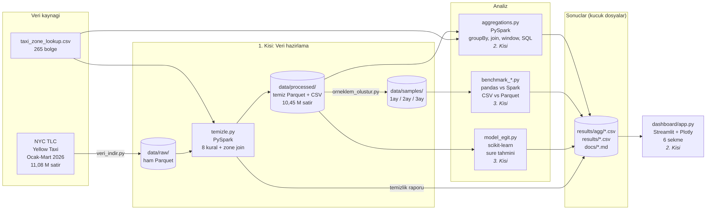

# NYC Taxi Buyuk Veri Analitigi

Bu proje Buyuk Veri Analitigi dersi (2026-2027 Guz) proje calismasidir.

**Problem:** Milyonlarca taksi yolculugundan sehir ici ulasim davranislarini analiz etmek.

**Arastirma sorusu:** Veri buyudukce klasik analiz yaklasimi ne zaman yetersiz kaliyor?

## Mimari



Ayrinti: `docs/mimari.md`

## Klasor yapisi

```
data/
  raw/         ham veri (TLC'den indirilen dosyalar)
  processed/   temizlenmis veri (CSV + Parquet)
  samples/     benchmark icin 1 ay / 2 ay / 3 ay veri setleri
results/       analiz sonuclari (kucuk CSV'ler, dashboard bunlari okur)
src/           Python scriptleri
dashboard/     Streamlit dashboard
notebooks/     analiz notebook'lari
docs/          veri sozlugu ve rapor dosyalari
sorular/       coktan secmeli sinav sorulari
```

Veri dosyalari buyuk oldugu icin GitHub'a yuklenmez, `data/` klasorleri bos gelir.

## Kurulum

Gereksinimler: Python 3.12, Java 17 veya 21.

```bash
py -3.12 -m venv .venv
.venv\Scripts\activate
pip install -r requirements.txt
```

Spark'i her scriptte ayni ayarlarla baslatmak icin `src/spark_baslat.py` kullanilir:

```python
from spark_baslat import spark_olustur, ham_dosyalar
spark = spark_olustur("uygulama_adi")
df = spark.read.parquet(*ham_dosyalar())
```

**Windows notlari:**

- Bilgisayarda birden fazla Python varsa Spark yanlis Python'u acip cokuyor.
  `spark_baslat.py` bunu `PYSPARK_PYTHON` ayariyla cozuyor.
- Windows'ta Hadoop'un `winutils.exe` dosyasi olmadan Spark `*` ile dosya ararken takiliyor
  ve diske dosya yazamiyor. Bu yuzden dosyalar `ham_dosyalar()` ile liste olarak okunuyor,
  cikti dosyalari ise pandas/pyarrow ile yaziliyor.

## Veri hazirlama adimlari (1. Kisi)

Scriptler proje ana klasorunden, bu sirayla calistirilir:

| Sira | Script | Ne yapar | Cikti |
|---|---|---|---|
| 1 | `python src/veri_indir.py` | Ocak-Mart 2026 verisini TLC'den indirir | `data/raw/` |
| 2 | `python src/veri_profili.py` | Bos oranlari, min/max, yuzdelik dilimler | `docs/veri_profili.md` |
| 3 | `python src/boyut_analizi.py` | Parquet / CSV / pandas RAM boyutlari | `docs/boyut_analizi.md` |
| 4 | `python src/temizle.py` | Hatali kayitlari temizler, bolge isimlerini ekler | `data/processed/`, `docs/temizlik_raporu.md` |
| 5 | `python src/orneklem_olustur.py` | Benchmark icin 1 ay / 2 ay / 3 ay veri setleri (3,5M / 6,7M / 10,5M satir) | `data/samples/`, `docs/orneklemler.md` |

Veri sozlugu: `docs/veri_sozlugu.md`

**Temiz veriyi okumak icin:**

```python
# pandas
import glob, pandas as pd
df = pd.concat([pd.read_parquet(f) for f in sorted(glob.glob("data/processed/parquet/*.parquet"))])

# Spark
import glob
from spark_baslat import spark_olustur
spark = spark_olustur("analiz")
df = spark.read.parquet(*sorted(glob.glob("data/processed/parquet/*.parquet")))
```

## Aggregation analizleri ve dashboard (2. Kisi)

| Sira | Komut | Ne yapar | Cikti |
|---|---|---|---|
| 6 | `python src/aggregations.py` | Saat, gun, bolge, rota, odeme turu ve havalimani analizleri (PySpark aggregation + join + window + Spark SQL), her analizin suresini olcer | `results/agg/*.csv`, `docs/aggregation_sonuclari.md` |
| 7 | `streamlit run dashboard/app.py` | Sonuclari tarayicida dashboard olarak gosterir | `http://localhost:8501` |

Rapor bolumu: `docs/rapor_kisi2_aggregation.md` - Proje mimarisi: `docs/mimari.md` - Sorular: `sorular/kisi2_sorular.md`

Kullanilan ileri analitik islemler:

- **Aggregation:** `groupBy().agg()` ile saatlik, gun x saat, bolge, rota, odeme turu ozetleri
- **Join:** zone tablosundan `service_zone` eklemek icin broadcast join
- **Window:** her saatin en yogun 5 bolgesi (`rank`), 7 gunluk hareketli ortalama (`avg ... rowsBetween(-6, 0)`), onceki gune gore degisim (`lag`), bolgenin ilce icindeki payi (`sum over partitionBy`)
- **Spark SQL:** odeme turu analizi

Dashboard ham veriyi degil, onceden hesaplanmis kucuk sonuc dosyalarini okur, bu yuzden hizli acilir:

| Bolum | Ne gosterir | Kaynak |
|---|---|---|
| Ozet | Ana sayilar, one cikan bulgular, arastirma sorusunun cevabi | hepsi |
| Veri ve temizlik | Temizlik kurallari (kural secilebilir), korunan durumlar, aranabilir veri sozlugu, dosya boyutlari | 1. Kisi |
| Zaman analizi | Olcut (sayi/ucret/mesafe/sure/hiz) ve gun secimiyle saatlik grafik, gun x saat isi haritasi, tarih araligi secilebilen gunluk seyir | 2. Kisi |
| Bolge analizi | Binis/inis, ilce, siralama, adet ve arama filtreleri; ilce matrisi, rotalar, saate gore en yogun bolgeler; CSV indirme | 2. Kisi |
| Odeme analizi | Odeme turu secildikce acilan karsilastirma, saat / mesafe / ilce kirilimlari; havalimani karsilastirmasi | 2. Kisi |
| Performans | pandas / Spark (sure veya bellek, yontem secimi), CSV / Parquet (veri buyuklugu secimi), analiz sureleri | 3. Kisi + 2. Kisi |
| Sure tahmini | Model karsilastirmasi, ozellik onemi, hata dagilimi, kurulum | 3. Kisi |
| Proje dokumanlari | Tum raporlar ve mimari sema uygulama icinde, indirilebilir | hepsi |
| Sinav sorulari | 10 soru, cevaplari kontrol edip puan gosterir | hepsi |

Dashboard ham veriyi degil kucuk sonuc dosyalarini (`results/`, `docs/`, `sorular/`) okur; Spark gerektirmez.
Grafiklerin altindaki yorumlar ve basliklardaki sayilar sonuc dosyalarindan hesaplanir; veri degisirse metinler de
kendiliginden guncellenir.
Gorunum PatiPortal tasarim sisteminden uyarlandi; tema ayarlari `.streamlit/config.toml` icinde.

## Gorev dagilimi

| Kisi | Gorev |
|------|-------|
| 1. Kisi | Veri temini, veri sozlugu, temizleme pipeline'i, CSV/Parquet donusumu, repo yapisi |
| 2. Kisi | PySpark aggregation analizleri, gorsellestirme ve dashboard |
| 3. Kisi | ML modeli (sure/ucret tahmini), Pandas vs PySpark ve CSV vs Parquet benchmark |

## Veri kaynagi

NYC Taxi & Limousine Commission (TLC) Trip Record Data:
https://www.nyc.gov/site/tlc/about/tlc-trip-record-data.page

Projede Yellow Taxi verisinin Ocak, Subat ve Mart 2026 aylari kullanildi (toplam 11.077.206 yolculuk).

| Dosya | Satir |
|-------|-------|
| yellow_tripdata_2026-01.parquet | 3.724.889 |
| yellow_tripdata_2026-02.parquet | 3.399.866 |
| yellow_tripdata_2026-03.parquet | 3.952.451 |
| taxi_zone_lookup.csv | 265 |

Veriyi indirmek icin:

```bash
python src/veri_indir.py
```
