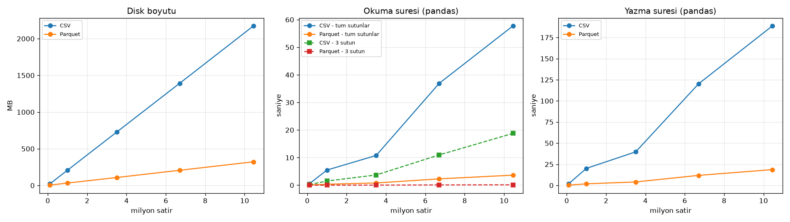

# CSV vs Parquet Benchmark

Her olcum 3 kez yapildi, tabloda ortanca (medyan) sure var. Okuma ve yazma pandas ile yapildi. 3 sutun: `trip_distance, fare_amount, pickup_hour`.

## Disk boyutu

| Veri seti | Satir | CSV (MB) | Parquet (MB) | CSV / Parquet |
|---|---|---|---|---|
| 100k | 100,000 | 20.8 | 3.9 | 5.3x |
| 1m | 1,000,000 | 207.8 | 33.5 | 6.2x |
| 1ay | 3,504,231 | 728.1 | 108.3 | 6.7x |
| 2ay | 6,703,593 | 1392.5 | 206.9 | 6.7x |
| 3ay | 10,452,582 | 2174.1 | 322.4 | 6.7x |

## Sureler (saniye)

| Satir | CSV yaz | Parquet yaz | CSV oku (tum) | Parquet oku (tum) | Hiz farki | CSV oku (3 sutun) | Parquet oku (3 sutun) | Hiz farki |
|---|---|---|---|---|---|---|---|---|
| 100,000 | 1.96 | 0.26 | 0.48 | 0.05 | 10.6x | 0.20 | 0.00 | 41.1x |
| 1,000,000 | 20.15 | 1.85 | 5.48 | 0.35 | 15.8x | 1.51 | 0.02 | 99.0x |
| 3,504,231 | 39.67 | 4.07 | 10.79 | 0.81 | 13.4x | 3.71 | 0.03 | 127.6x |
| 6,703,593 | 120.24 | 11.86 | 36.91 | 2.29 | 16.1x | 10.97 | 0.09 | 128.2x |
| 10,452,582 | 188.72 | 18.68 | 57.74 | 3.64 | 15.9x | 18.77 | 0.13 | 148.2x |

