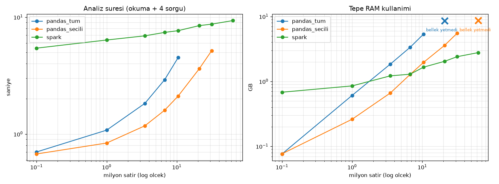

# Pandas vs PySpark Benchmark

Her olcum ayri bir Python surecinde 3 kez yapildi, tabloda ortanca (medyan) deger var. Sure = dosyayi okuma + 4 analiz sorgusu. Spark icin ayrica oturum baslatma suresi verildi. Tepe RAM = olcum boyunca surecin (Spark'ta Java dahil) ulastigi en yuksek bellek.

Bilgisayar: 15 GB RAM, 16 mantiksal cekirdek. Bos RAM 1.0 GB'in altina inerse olcum durduruldu ve 'bellek yetmedi' yazildi. 20M, 30M ve 60M setleri 3ay verisinin 2, 3 ve 6 kopyasidir; sadece performans olcumu icindir, analiz sonucu cikarilmaz.

| Satir | Yontem | Sure (sn) | Tepe RAM (GB) | Spark baslatma (sn) | Durum |
|---|---|---|---|---|---|
| 100,000 | pandas_secili | 0.68 | 0.08 | - | tamam |
| 100,000 | pandas_tum | 0.70 | 0.08 | - | tamam |
| 100,000 | spark | 5.43 | 0.68 | 6.3 | tamam |
| 1,000,000 | pandas_secili | 0.84 | 0.26 | - | tamam |
| 1,000,000 | pandas_tum | 1.08 | 0.61 | - | tamam |
| 1,000,000 | spark | 6.38 | 0.85 | 6.4 | tamam |
| 3,504,231 | pandas_secili | 1.18 | 0.66 | - | tamam |
| 3,504,231 | pandas_tum | 1.83 | 1.85 | - | tamam |
| 3,504,231 | spark | 6.92 | 1.22 | 6.4 | tamam |
| 6,703,593 | pandas_secili | 1.60 | 1.28 | - | tamam |
| 6,703,593 | pandas_tum | 2.92 | 3.35 | - | tamam |
| 6,703,593 | spark | 7.41 | 1.29 | 6.4 | tamam |
| 10,452,582 | pandas_secili | 2.11 | 1.97 | - | tamam |
| 10,452,582 | pandas_tum | 4.51 | 5.36 | - | tamam |
| 10,452,582 | spark | 7.66 | 1.66 | 6.4 | tamam |
| 20,905,164 | pandas_secili | 3.62 | 3.61 | - | tamam |
| 20,905,164 | pandas_tum | - | - | - | bellek yetmedi |
| 20,905,164 | spark | 8.47 | 2.04 | 6.3 | tamam |
| 31,357,746 | pandas_secili | 5.16 | 5.51 | - | tamam |
| 31,357,746 | pandas_tum | - | - | - | atlandi (kucuk boyutta basarisiz) |
| 31,357,746 | spark | 8.71 | 2.40 | 6.3 | tamam |
| 62,715,492 | pandas_secili | - | - | - | bellek yetmedi |
| 62,715,492 | pandas_tum | - | - | - | atlandi (kucuk boyutta basarisiz) |
| 62,715,492 | spark | 9.35 | 2.78 | 6.4 | tamam |

