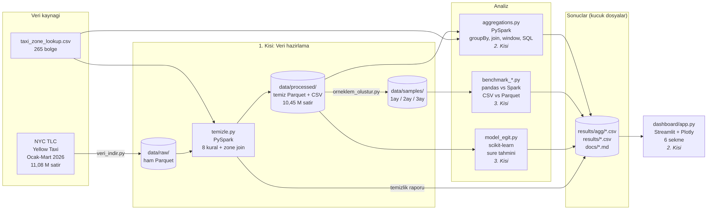
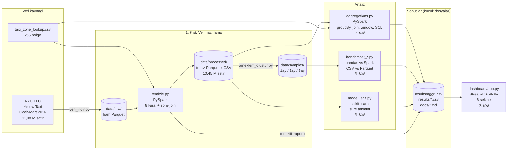

# Proje Mimarisi

Verinin kaynaktan dashboard'a kadar izledigi yol. Her kutunun altinda ureten script ve sorumlu kisi yazar.

## Katmanlar

| Katman | Teknoloji | Neden |
|---|---|---|
| Depolama | Parquet (ZSTD / Snappy) | Sutun bazli: sadece gereken sutunlar okunur, CSV'den ~6,7 kat kucuk |
| Isleme | PySpark (yerel mod, `local[*]`) | Veri bellege sigmasa da parca parca isler; ayni kod kumeye tasinabilir |
| Karsilastirma | pandas | Tek makinede klasik yaklasim; benchmark'ta referans |
| Model | scikit-learn | Yolculuk suresi tahmini |
| Sunum | Streamlit + Plotly | Hazir sonuc dosyalarini okur, Spark gerektirmez, aninda acilir |

**Hesaplama ve gorsellestirme ayri.** Agir isler (temizlik, aggregation, benchmark, model) bir kez calisip kucuk sonuc
dosyalari uretir. Dashboard yalnizca bu dosyalari okur. Boylece 10 milyon satiri her etkilesimde yeniden islemek gerekmez.
