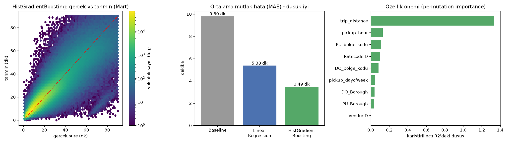

# Yolculuk Suresi Tahmin Modeli

**Soru:** Yolcu taksiye bindigi anda bilinen bilgilerle yolculugun kac dakika surecegi tahmin edilebilir mi?

- Hedef: `trip_duration_min` (dakika)
- Egitim: 2026-01 + 2026-02 (6,703,593 yolculuk)
- Test: 2026-03 (3,748,989 yolculuk). Model bu ayi egitimde hic gormedi.
- Ozellikler: trip_distance, PULocationID, DOLocationID, PU_Borough, DO_Borough, pickup_hour, pickup_dayofweek, RatecodeID, VendorID
- Kullanilmayanlar (veri sizintisi): inis zamani, ortalama hiz, ucret / toplam / bahsis. Bunlar yolculuk bitince belli olur ve sureyi dolayli olarak icerir.

## Sonuclar (Mart test verisi)

| Model | MAE (dk) | RMSE (dk) | R2 | Egitim suresi (sn) |
|---|---|---|---|---|
| Baseline (ortalama) | 9.80 | 14.44 | -0.000 | 0.0 |
| Linear Regression | 5.38 | 8.38 | 0.663 | 5.1 |
| HistGradientBoosting | 3.49 | 5.81 | 0.838 | 50.1 |

## Ozellik onemi

Bir ozelligin degerleri rastgele karistirildiginda modelin R2 degeri ne kadar dusuyor? Cok dusuyorsa model o ozellige cok guveniyor demektir. (Test verisinden 200 bin satirlik orneklem, 3 tekrar.)

| Ozellik | R2 dususu |
|---|---|
| trip_distance | 1.336 |
| pickup_hour | 0.131 |
| PU_bolge_kodu | 0.112 |
| RatecodeID | 0.099 |
| DO_bolge_kodu | 0.084 |
| pickup_dayofweek | 0.045 |
| DO_Borough | 0.041 |
| PU_Borough | 0.036 |
| VendorID | 0.002 |

## Hata, yolculuk uzunluguna gore (HistGradientBoosting)

| Gercek sure | Yolculuk | MAE (dk) |
|---|---|---|
| 0-10 dk | 1,267,414 | 1.99 |
| 10-20 dk | 1,420,533 | 2.75 |
| 20-40 dk | 812,927 | 4.60 |
| 40-60 dk | 161,360 | 8.74 |
| 60+ dk | 86,755 | 17.32 |

